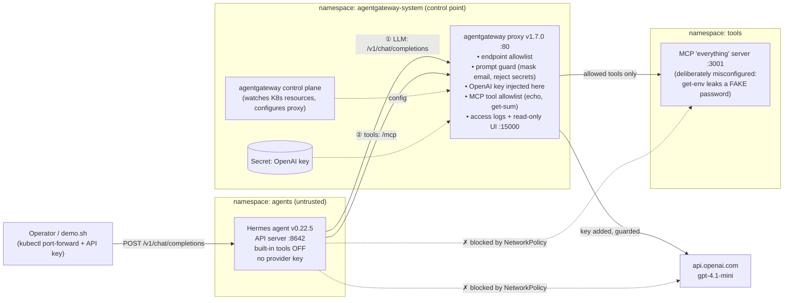

# Architecture: one control point for agent traffic

**Goal:** every agent's **model** traffic and **tool** traffic goes through one control point, where the platform team can see what the agent did and stop what it shouldn't do.

**What's deployed:** a local kind cluster (Kubernetes in Docker) with three namespaces, one per trust zone. Everything is plain Kubernetes resources in `manifests/`, applied by `scripts/setup.sh`.

## The two traffic paths

| | ① Model traffic | ② Tool traffic |
|---|---|---|
| Agent calls | `http://agentgateway-proxy.agentgateway-system.svc.cluster.local/v1/chat/completions`, model `openai/gpt-4.1-mini-2025-04-14`, dummy key | same host, `/mcp` (MCP Streamable HTTP) |
| Gateway resource | `AgentgatewayModel` (`manifests/20-llm-openai.yaml`) | `AgentgatewayBackend` + `HTTPRoute` (`31-mcp-backend-route.yaml`) |
| Policy | **Prompt guard** (inline): Mask emails; Reject `sk-…` / `AKIA…` / `ASIA…` with a JSON 403. Gateway **endpoint allowlist** (`21-…`): only `/v1/chat/completions`, `/v1/models`, `/mcp` | **MCP authorization** (`32-mcp-authz.yaml`): allow `echo`, `get-sum`; everything else hidden from `tools/list` and refused on `tools/call` (JSON-RPC -32602) |
| Credentials | Gateway injects the OpenAI key from a Secret only it can read | none needed |
| Evidence | access log: model, tokens, every guard's action (allow/mask/reject), reason | access log: MCP method, target, tool name, `authorization denied`, reason |

## Where policy lives, and why

**In the gateway, not the agent.** The agent only knows one address. Swapping the agent (Hermes → OpenClaw → kagent), the model (OpenAI → Anthropic/Ollama) or the tool server changes no policy, and one policy set covers every agent. Policies are Kubernetes resources: reviewable in PRs, GitOps-able, auditable.

## Defence in depth: four independent layers

1. **Gateway policy:** prompt guard, endpoint allowlist, MCP tool allowlist (default deny).
2. **No keys in the agent:** the OpenAI key exists only in a Secret in `agentgateway-system` (0 occurrences in the agent's env, files, namespace or logs, verified). Hermes holds a dummy key.
3. **Agent configured to use only the gateway:** Hermes' API server gets exactly one toolset, the gateway MCP server (`platform_toolsets.api_server: [platform_tools]`), and every built-in toolset (terminal, files, web, browser, code execution, memory, …) is also stripped globally. No fallback providers; model-catalog phone-home disabled; no Kubernetes API token.
4. **Network makes any other route impossible** (`50-networkpolicy.yaml`, enforced by kindnet):
   - `agents` egress: DNS + gateway proxy pods on :80 only. Ingress: none (only `kubectl port-forward` + bearer key).
   - `tools` ingress: gateway proxy pods only. Egress: none (the server's URL-fetching tool can't reach out).

Even a misconfigured or prompt-injected agent has no path to OpenAI, the tool server or the internet except through the gateway. **Fail closed:** with the gateway down, the agent returns an error and nothing goes anywhere else.

## Choices and why

| Choice | Why |
|---|---|
| **Hermes** (over OpenClaw) | First-class "custom OpenAI-compatible endpoint" + remote MCP over HTTP + an OpenAI-compatible API server to drive it headless; official multi-arch image. OpenClaw was the documented fallback. |
| **agentgateway v1.7.0, Kubernetes mode** | The single control point for model and tool traffic. 1.7's model-centric `AgentgatewayModel` API; request guards scan tool output by default. |
| **OpenAI `gpt-4.1-mini-2025-04-14`** (pinned snapshot) | Reliable tool calling, cheap; `gpt-4o-mini` documented as fallback. Hermes marks it non-reasoning. |
| **MCP "everything" reference server, pinned 2.1.0** | Has a harmless allowed tool (`get-sum`) and a dangerous one (`get-env`). Built into a local image (no npm download at pod start). Docker Hub's image is 18 months stale. |
| **kind, single node** | Free, local, 5 GB Docker budget. kindnet enforces NetworkPolicy (tested, so no Calico needed). |
| **Regex guards** | Deterministic and explainable for a demo. Limits documented (DEMO.md); production layers moderation/webhook guards on top. |

## Versions (all pinned)

kind v0.33.0 (Kubernetes v1.37.0) · Gateway API CRDs v1.6.3 · agentgateway charts v1.7.0 · Hermes `nousresearch/hermes-agent:v0.22.5` · `@modelcontextprotocol/server-everything@2.1.0` on `node:24-alpine@sha256:116b…` · MCP Inspector CLI 0.21.2.

## Does it scale?

- **The gateway proxy is stateless** → scale replicas horizontally behind its Service. The control plane is separate from the data plane, so policy changes don't restart traffic. NetworkPolicies select proxy pods by label, so extra replicas are covered automatically.
- **Many teams / agents:** one namespace per team or agent, each Deployment pointed at the gateway; no gateway code changes to add an agent. Next step: **per-agent identity** (JWT on MCP and LLM routes, rules like `jwt.sub == "team-a-agent" && mcp.tool.name == "echo"`). The CRD already supports `jwtAuthentication` and MCP `authentication`.
- **Provider-agnostic:** add `anthropic/*` or `ollama/*` models in gateway config; agents unchanged. Failover/weighted routing via virtual models.
- **Policy as code:** everything is a K8s resource → Argo CD/Flux, PR review, audit trail.

## Production path (documented, not built; out of scope for this proof of concept)

- **HA gateway:** ≥2 proxy replicas across zones + PodDisruptionBudget (one Helm/GatewayParameters change), Service as an internal LB or ClusterIP.
- **TLS/mTLS** everywhere (agent→gateway, gateway→MCP); secrets from Vault / External Secrets, not `kubectl create secret`.
- **Real identity provider** issuing agent JWTs; per-agent model and tool rules; rate limits and cost budgets per team.
- **Layered guardrails:** regex + `openAIModeration` / webhook / vendor DLP; start new patterns in `Audit` mode to measure false positives; add response-side guards and argument-level MCP rules (model output → tool input path).
- **Observability:** OTel traces + metrics, access logs shipped to the customer's SIEM.
- **Close the residual paths:** DNS exfiltration (FQDN-aware egress policy / CoreDNS policy / DNS logging), ingress policies on `agentgateway-system`, Hermes container hardening (non-root where the image allows).
- GitOps-managed policies with review; multi-cluster later.
