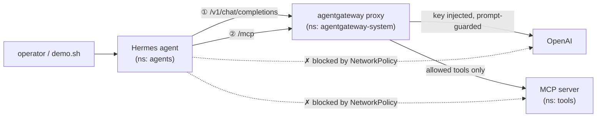

# Agentic AI Guardrails: Securing AI Agents and MCP Tools on Kubernetes

Autonomous agents call LLMs **and** run tools. This proof of concept puts an agent's **model traffic and tool traffic through a single control point** on Kubernetes. The gateway enforces a prompt guard on LLM requests and tool-level authorization on MCP calls, injects the provider key the agent never holds, and logs every decision. A [Hermes](https://github.com/NousResearch/hermes-agent) agent runs in the cluster behind [agentgateway](https://agentgateway.dev); NetworkPolicy makes the gateway its only way out. Runs locally on kind, with no cloud account needed.

## Architecture

Full write-up (layers, choices, scaling, production path): **[ARCHITECTURE.md](ARCHITECTURE.md)**



- **① Model traffic:** agent → gateway `AgentgatewayModel` (`openai/*`) → OpenAI. Prompt guard masks emails and rejects API keys (403); an endpoint allowlist closes unguarded LLM endpoints.
- **② Tool traffic:** agent → gateway `/mcp` → MCP server. Tool allowlist (`echo`, `get-sum`); everything else is hidden from `tools/list` and refused on `tools/call`.

**Four defence layers**
1. **Gateway policy:** prompt guard, endpoint allowlist, MCP tool allowlist (default deny).
2. **No keys in the agent:** the OpenAI key lives only in a Secret in the gateway's namespace; the agent has a dummy.
3. **Agent configured gateway-only:** its only toolset is the gateway MCP server; all built-in tools (shell, files, web, code…) are off.
4. **Network:** the agent can reach only DNS and the gateway; only the gateway can reach the MCP server; the MCP server has no egress.

## What's demonstrated

| Requirement | Proven by |
|---|---|
| Agent running on Kubernetes | `verify.sh` 6a; Hermes Deployment in `agents` |
| Agent's LLM calls go through agentgateway | `demo.sh agent` (gateway logs the agent pod's LLM calls); 7a: direct OpenAI from the agent pod → no connection |
| Agent's tool calls go through agentgateway over MCP | `demo.sh agent` (gateway logs the agent's `tools/call get-sum`); 7b: direct MCP → no connection |
| Prompt control: one prompt through, one stopped | `demo.sh normal` (200), `mask` (email → `<EMAIL_ADDRESS>`), `reject` (403, no tokens sent), `agent-blocked` (through the agent); checks 3a–3g |
| MCP control: agent refused a tool | `demo.sh tool-denied` (`get-env` hidden + direct call → `-32602`) and `agent-refused` (live policy change; the gateway denies the agent's `echo` call); checks 5a–5f |
| Show what happened, including blocked requests | every demo scene prints the gateway's access-log decision; `demo.sh logs`; read-only UI via `demo.sh ui` |

Plus: `demo.sh bypass` (no route around the gateway), checks 7a–7g (lockdown, with network-level evidence only), 8a–8b (demo repeatable, identical outcomes).

## Quickstart

**Prerequisites:** Docker (≥ 5 GB RAM allocated), [kind](https://kind.sigs.k8s.io/), kubectl, helm (tested with Helm 4), jq, Node.js (for the MCP Inspector CLI via `npx`), openssl. Tested on macOS / Apple Silicon.

**1. Create `.env`** in the repo root (gitignored, never committed):
```sh
OPENAI_API_KEY=sk-...
```
Use a throwaway key with a spending cap. `setup.sh` adds a generated `HERMES_API_SERVER_KEY` to the same file. Keys are never printed.

**2. Build, test, demo:**
```sh
scripts/setup.sh          # kind cluster → Gateway API CRDs → agentgateway → MCP server → Hermes → NetworkPolicies (idempotent)
scripts/verify.sh all     # automated acceptance tests; prints PASS/FAIL with evidence
scripts/demo.sh all       # all demo scenes (DEMO_PAUSE=1 to step through); or one scene, e.g. scripts/demo.sh mask
```
A fresh setup takes ~2 min with cached images, 5–8 min if the ~4 GB Hermes image must be downloaded.

## Repo layout

| Path | What |
|---|---|
| `manifests/00-namespaces.yaml` | namespaces: `agentgateway-system`, `agents`, `tools` |
| `manifests/10-gateway.yaml` | Gateway (the proxy) |
| `manifests/20-llm-openai.yaml` | LLM route + prompt guard (key comes from a Secret created by `setup.sh`) |
| `manifests/21-gateway-endpoint-allowlist.yaml` | only `/v1/chat/completions`, `/v1/models`, `/mcp` allowed |
| `manifests/30-mcp-server.yaml`, `31-…`, `32-mcp-authz.yaml` | MCP server, its gateway backend/route, tool allowlist |
| `manifests/40-hermes.yaml` | Hermes agent: config, Deployment, Service |
| `manifests/50-networkpolicy.yaml` | network lockdown |
| `manifests/demo/` | policy variant applied live (and reverted) by `demo.sh agent-refused` |
| `mcp-server/Dockerfile` | pinned MCP reference server image, built locally |
| `scripts/` | `setup.sh`, `verify.sh`, `demo.sh`, `teardown.sh`, shared `lib.sh` |
| `evidence/` | tool list captured before the MCP policy (used by the demo) |
| `kind-config.yaml` | single-node kind cluster |
| `ARCHITECTURE.md` | design, choices, scaling, production path |
| `DEMO.md` | talk track, live-change rehearsals, Q&A prep |
| `WHAT_BROKE.md` | every problem hit: symptom → cause → fix → time |
| `CLAUDE.md` | working conventions: test-first, independent review, secret handling |
| `.claude/agents/qa-reviewer.md` | the review checklist applied after each milestone |

## Known limitations and production path

Not production-hardened (out of scope for this proof of concept). Highlights:
- **Regex guards** have false positives and are easy to evade. Layer them with moderation/webhook/DLP guards ([DEMO.md](DEMO.md#prompt-guard-what-it-does-and-doesnt-catch-be-upfront)).
- **Model output → tool arguments** is not prompt-guarded (it's MCP traffic). Options: response guards, argument-level MCP rules.
- **DNS** is the one residual egress path (via cluster DNS). Fix with FQDN-aware egress policy.
- Single gateway replica, no TLS, Secrets via `kubectl`, no per-agent identity yet.

Production path (HA replicas, mTLS, real IdP + per-agent JWT rules, Vault, OTel to a SIEM, GitOps): **[ARCHITECTURE.md](ARCHITECTURE.md#production-path-documented-not-built-out-of-scope-for-this-proof-of-concept)**.

## Teardown

See **[TEARDOWN.md](TEARDOWN.md)**: `scripts/teardown.sh` deletes the cluster; then **revoke the OpenAI key** in the OpenAI dashboard and delete `.env`.
